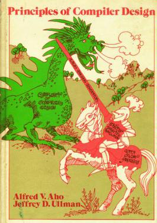

# CSE425_Compiler_Design_Lab
This repository contains my workings for the lab assignments of compiler design course at IIT (BHU)

**Website:** [repsick3r.github.io/CSE425_Compiler_Design_Lab](https://repsick3r.github.io/CSE425_Compiler_Design_Lab/)

    

| Lab | Topic |
| --- | --- |
| [Lab 1](Lab1/README.md) | Phases of compiling a C program |
| [Lab 2](Lab2/README.md) | Lexical analyser in C++ |
| [Lab 3](Lab3/README.md) | Lexical analysis with LEX |
| [Lab 4](Lab4/README.md) | Recursive descent parser |
| [Lab 5](Lab5/README.md) | Predictive parser |
| [Lab 6](Lab6/README.md) | Canonical LR parser |
| [Lab 7](Lab7/README.md) | 3-D array declarations with LEX and YACC |
